<div align="center">


# Heros NoteBook — Jupyter Studio Extension

### Open, read, **run real Python**, edit, search and export `.ipynb` notebooks — inside your browser.
### 160 free tools · Pyodide sandbox kernel · Builder studio · Variable inspector · 100% Local · Free · Unlimited

<br/>

[](./manifest.json)
[](https://developer.chrome.com/docs/extensions/mv3/)
[-3776AB?style=for-the-badge&logo=python&logoColor=white)](https://pyodide.org/)
[](#privacy-and-security)
[](#why-heros-notebook)
[](#themes-and-eye-comfort)
[](#responsive-and-mobile-first)

<br/>

[](https://pyodide.org/)
[](#installation--30-seconds)
[](#installation--30-seconds)
[](#installation--30-seconds)
[](#installation--30-seconds)
[](./LICENSE)
[](#tech-stack)

<br/>

**Website:** `https://ahmedbakr78.github.io/Heros_Jupter/` · **Issues:** [Report a bug](https://github.com/Ahmedbakr78/Heros_Jupter/issues/new/choose) · **Feature request:** [Request it](https://github.com/Ahmedbakr78/Heros_Jupter/issues/new/choose)

> **One-line description for the GitHub About box (copy-paste, no emojis):**
> `Heros NoteBook — open, read, run, edit and export .ipynb notebooks in your browser. Real Python via Pyodide sandbox, builder studio, variable inspector. 100% local, free and unlimited.`

</div>

---

## Table of Contents

- [Description (short, medium, long)](#description-short-medium-long)
- [Why Heros NoteBook?](#why-heros-notebook)
- [Demo / How it looks](#demo--how-it-looks)
- [Feature Universe — All 160 Tools](#feature-universe--all-160-tools)
- [Heros NoteBook vs Everyone Else](#heros-notebook-vs-everyone-else)
- [Architecture and Diagrams](#architecture-and-diagrams)
- [The Python Kernel — Pyodide Sandbox Engine](#the-python-kernel--pyodide-sandbox-engine)
- [Data Flow and Notebook Lifecycle](#data-flow-and-notebook-lifecycle)
- [Sequence Flows — End-to-End Journeys](#sequence-flows--end-to-end-journeys)
- [Security Model — Sandboxing an Untrusted Notebook](#security-model--sandboxing-an-untrusted-notebook)
- [State Management and Persistence](#state-management-and-persistence)
- [Export Engine](#export-engine)
- [Search and Outline Engine](#search-and-outline-engine)
- [Builder Studio and Wizards](#builder-studio-and-wizards)
- [Privacy and Security](#privacy-and-security)
- [Installation — 30 Seconds](#installation--30-seconds)
- [Usage Guide](#usage-guide)
- [Keyboard Shortcuts — Complete Map](#keyboard-shortcuts--complete-map)
- [Themes and Eye Comfort](#themes-and-eye-comfort)
- [Responsive and Mobile-First](#responsive-and-mobile-first)
- [Performance Engineering](#performance-engineering)
- [Error Handling and Resilience](#error-handling-and-resilience)
- [Accessibility](#accessibility)
- [Internals — Inside the Code](#internals--inside-the-code)
- [Compatibility Matrix](#compatibility-matrix)
- [Project Stats](#project-stats)
- [Repository Structure](#repository-structure)
- [Tech Stack](#tech-stack)
- [Roadmap](#roadmap)
- [Contributing](#contributing)
- [FAQ — 30 Questions](#faq--30-questions)
- [Changelog and Releases](#changelog-and-releases)
- [GitHub Topics, About and Website Setup](#github-topics-about-and-website-setup)
- [Related Projects](#related-projects)
- [License and Credits](#license-and-credits)

---

## Description (short, medium, long)

Pick the length you need. All three are emoji-free and ready to paste into GitHub About, the website meta tags, or a store listing.

**Short (GitHub About):**

```text
Heros NoteBook — open, read, run, edit and export .ipynb notebooks in your browser. Real Python via Pyodide sandbox, builder studio, variable inspector. 100% local, free and unlimited.
```

**Medium (one paragraph):**

```text
Heros NoteBook is a Manifest V3 browser extension that turns any Chromium browser into a private Jupyter studio. Open .ipynb files from disk, URL, drag-and-drop or paste; run real Python (Pyodide, WebAssembly) in an isolated sandbox kernel with matplotlib inline capture and rich displays; edit, split, reorder and search every cell; export to .ipynb, .py, .md, .html, .txt or print-ready PDF. 160 tools including a builder studio, variable inspector, package manager, plot gallery and run history. No server, no account, no telemetry — your notebooks never leave your machine.
```

**Long (README intro / website hero):**

```text
Heros NoteBook is the fastest, most private and most beautiful way to open Jupyter notebooks in a browser. It reads standard .ipynb files, runs real Python 3 in a WebAssembly Pyodide kernel isolated inside a sandboxed iframe, and ships a complete authoring studio on top: cell editing with undo/redo, full-notebook search across code, markdown and outputs, a live variable inspector with DataFrame shape badges, a package manager for one-tap pip installs, a plot gallery that captures every matplotlib figure, a run history with per-cell timings, and a builder studio of snippet galleries, table builders and chart wizards. Everything renders in the Heros design system — ultra-rounded floating cards, pill toolbars, Studio-white light mode and a true dark theme, six accent colors, night/sepia/dim page tints, focus mode and a mobile drawer. 100% of the work happens on your machine: no servers, no accounts, no analytics, no limits. MIT licensed, free forever.
```

---

## Why Heros NoteBook?

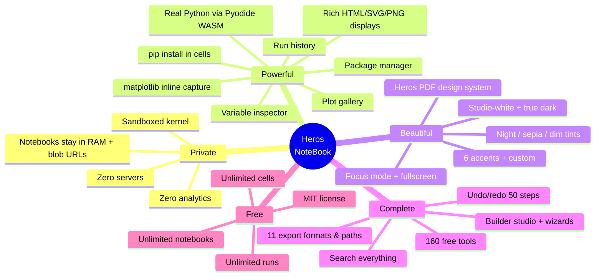

| Problem | Heros NoteBook answer |
|---|---|
| JupyterHub needs a server, an account and a lot of RAM | Open the panel, drop a file, press `Shift+Enter` — zero setup |
| nbviewer renders but never runs | A real Python kernel runs locally in WebAssembly |
| Desktop Jupyter is heavy and installs Python globally | One extension, sandboxed WASM, nothing on your PATH |
| Cloud notebooks upload your data | Nothing ever leaves the machine |
| Other extensions are viewers only | Full edit / search / export / builder studio |
| Ugly, cramped notebook UIs | The Heros design system — floating cards, pill tabs, dark + light |

---

## Demo / How it looks

| Screen | What you see |
|---|---|
| Notebook view | Cells as floating cards, execution badges, pill tab bar, floating toolbar |
| Run | `Shift+Enter` queues the cell in the sandbox kernel; timers tick per cell |
| Variable inspector | Live list of kernel variables with type, preview and DataFrame shapes |
| Builder studio | Snippet gallery, table builder, chart wizard — tap to insert at cursor |
| Search | Full-notebook match list across code, markdown and outputs |
| Themes | Studio-white, true dark, night/sepia/dim page tints, 6 accents |

> Screenshots welcome! Open an issue or PR with captures from your machine.

---

## Feature Universe — All 160 Tools

Press **`F`** inside the app for the runnable, filterable list. Every card executes an action. Grouped below with counts (18+14+19+11+14+13+10+14+12+10+12+8+5 = **160**).

### Open & View (18)

| # | Tool | How |
|---|---|---|
| 1 | Open `.ipynb` file | `Ctrl+O` / Open button |
| 2 | Drag & drop anywhere | Drop on the page |
| 3 | Open from URL | Open → URL tab |
| 4 | `?nb=` deep open | Append `?nb=<url>` to viewer |
| 5 | Paste notebook JSON | Paste into empty state |
| 6 | Demo notebook | Load demo button |
| 7 | Recent notebooks (25) | Sidebar → Recents |
| 8 | Resume at last cell | Auto on reopen |
| 9 | Notebook header | Title bar with kernelspec |
| 10 | Kernelspec badge | `python3 · Pyodide` chip |
| 11 | Trust bar | Untrusted HTML sanitizing notice |
| 12 | HTML sanitizing | Safe render of untrusted output |
| 13 | Lazy images | Outputs load images on view |
| 14 | Collapse all outputs | Toolbar action |
| 15 | Execution badges | `[12]`, timing, error state |
| 16 | Auto-collapsed streams | Long stdout folds |
| 17 | Cell permalinks | `#cell-N` links |
| 18 | Go to cell number | Navigator input |

### Run Python (14)

| # | Tool | How |
|---|---|---|
| 1 | Run cell + advance | `Shift+Enter` |
| 2 | Run cell, stay | `Ctrl+Enter` |
| 3 | Run + insert below | Toolbar |
| 4 | Run all cells | Run menu |
| 5 | Run cells above | Run menu |
| 6 | Restart kernel | Run menu |
| 7 | Load kernel now | Kernel badge / first run |
| 8 | `!pip install` support | In any cell |
| 9 | `input()` prompts | Cell-level prompt dialog |
| 10 | matplotlib inline | PNG auto-capture to output |
| 11 | Rich display | HTML / SVG / PNG / Markdown / JSON |
| 12 | Per-cell timers | Auto |
| 13 | Kernel info | Kernel badge → info |
| 14 | Safe magics | Whitelisted `%` / `!` handling |

### Edit (19)

Add code · Add markdown · Add cell above · Split at cursor · Cut · Copy · Paste · Duplicate · Delete · Move up · Move down · Convert to code · Convert to markdown · Convert to raw · Edit/preview toggle · Collapse source · Collapse outputs · Undo (50 steps) · Redo (50 steps).

### Search & Navigate (11)

Full-notebook search (code + markdown + outputs) · Match case · Whole word · Previous / next match · Export results · Cell navigator · Outline (headings + `def` / `class`) · Go to cell · Jump to first error · Back to top · Keyboard `J`/`K` traversal.

### Export & Share (14)

Save `.ipynb` · Export `.py` · Export `.md` · Export `.html` · Export `.txt` · Print / PDF · Copy source · Copy outputs · Download plot images · Backup / restore JSON · Share cell link · Duplicate notebook · Validate notebook schema · Copy execution stats.

### Themes & Comfort (13)

Dark · Light · System · 6 accent colors + custom picker · Night tint · Sepia tint · Dim tint · 4 content widths · Font scaling · Focus mode · Fullscreen · Cell hover polish · Reduce-motion switch.

### Study & Marks (10)

Highlight selection (`H`) · Underline (`U`) · Strike (`S`) · Copy selection · Note from selection · Auto-saved marks · Cell bookmarks · Notebook notes · Callouts + tables · Safe external links.

### Productivity (14)

Stopwatch + laps · Counter A · Counter B · Counter C + steps · Todo add · Todo priorities · Todo filters · Todo export · Todo clear-done · Habit tracker · Streaks · Day streak · Auto reading timer · Session clock.

### Platform & Privacy (12)

Manifest V3 · Popup control center · Right-click open · Auto-open `file://` · Auto-open `https://` · File-permission helper · 100% local · Zero tracking · Offline view / edit / export · Zero dependencies · Silent boot · MIT free forever.

### Lab (10)

Lint notebook · Summary · Keywords · Readability · Copy outline · Copy stats · Validate · Execution stats · Kernel info · Word counts.

### Build — Snippet Studio + Wizards (12)

Snippet gallery (14 Python + 8 Markdown) · Table builder dialog · Chart wizard (line / bar / scatter / hist) · CSV loader · Quick line chart · Pip installer cell · JSON loader · Callout builder · Math block · Details fold · Banner box · Task-list block.

### Data — Live Kernel Power (8)

Variable inspector · Variable detail · Print-cell · Package manager (install + list) · One-tap pip · Plot gallery · Run history with timings · Auto variable refresh · Shape badges for DataFrames.

### Design — Perfect Light + Dark (5)

Studio-white light mode · Deepened true dark · Reduce-motion · Profile color · Studio profile.

---

## Heros NoteBook vs Everyone Else

| Capability | Heros NoteBook | nbviewer | JupyterLab (desktop) | Cloud notebooks | Other extensions |
|---|---|---|---|---|---|
| Open local `.ipynb` | ✅ | ❌ | ✅ | ❌ upload | ✅ |
| Run Python | ✅ Pyodide WASM | ❌ | ✅ | ✅ | ❌ mostly |
| No server / account | ✅ | ✅ | ❌ heavy install | ❌ | ✅ |
| 100% local data | ✅ | ✅ | ✅ | ❌ | ✅ |
| Edit + undo/redo | ✅ | ❌ | ✅ | ✅ | ⚠️ limited |
| Full-text search incl. outputs | ✅ | ❌ | ⚠️ | ⚠️ | ❌ |
| Variable inspector | ✅ | ❌ | ✅ plugin | ✅ | ❌ |
| pip install in cell | ✅ | ❌ | ✅ | ✅ | ❌ |
| Plot gallery | ✅ | ❌ | ❌ | ❌ | ❌ |
| Builder studio / wizards | ✅ | ❌ | ❌ | ❌ | ❌ |
| Export .py/.md/.html/.txt/PDF | ✅ all | ❌ | ⚠️ | ⚠️ | ⚠️ |
| Dark + light + tints | ✅ | ❌ | ⚠️ | ⚠️ | ⚠️ |
| Mobile-ready | ✅ | ❌ | ❌ | ⚠️ | ❌ |
| Free + unlimited + MIT | ✅ | ✅ | ✅ | ❌ quotas | ⚠️ |

---

## Architecture and Diagrams

### System components

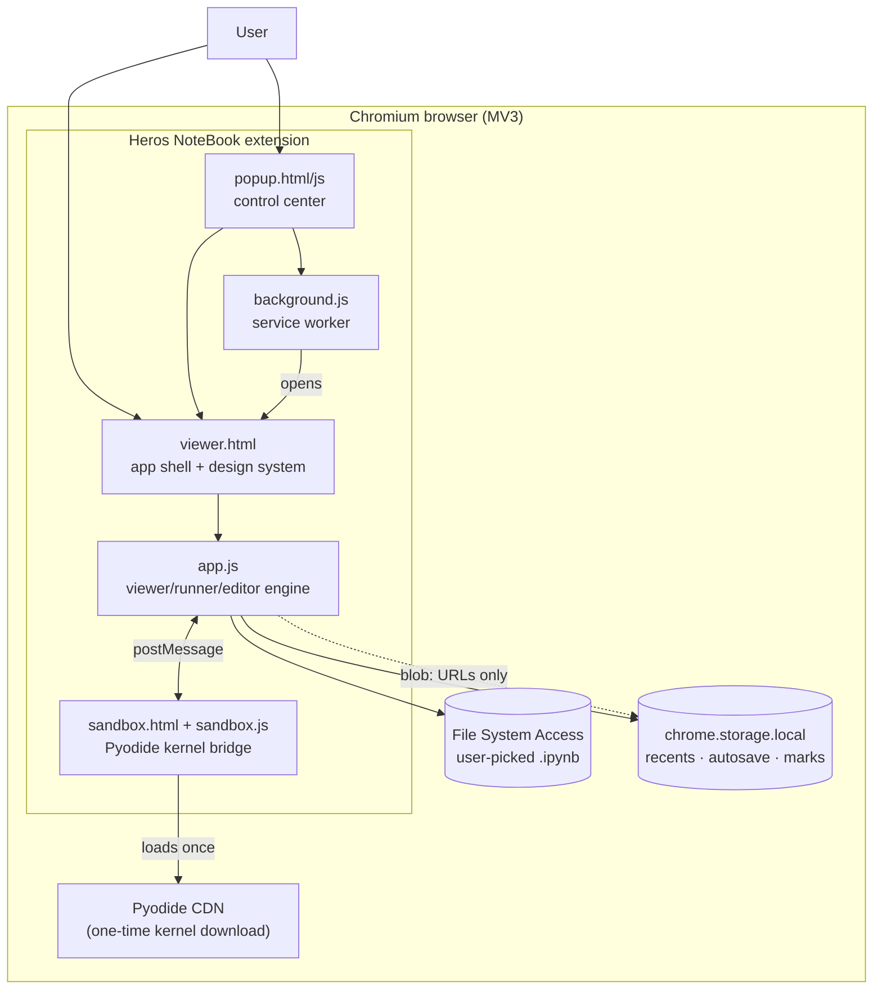

### Extension surfaces

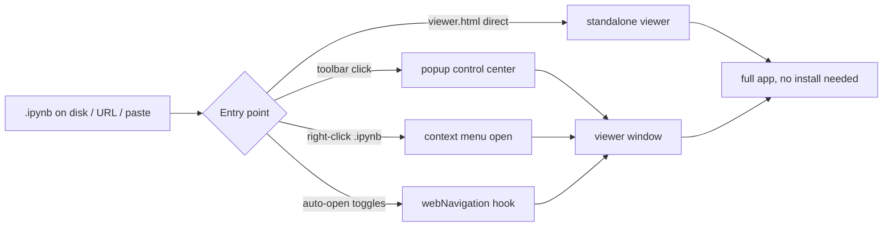

### Notebook document model

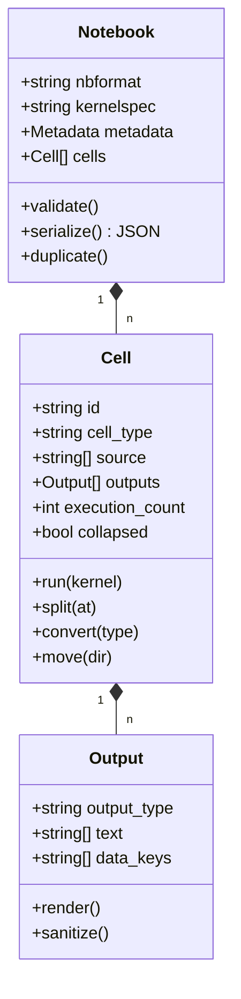

---

## The Python Kernel — Pyodide Sandbox Engine

The kernel is **Pyodide** (CPython compiled to WebAssembly) running inside a sandboxed `<iframe>` — a page the extension CSP allows to execute scripts, while the extension pages themselves stay `script-src 'self'`.

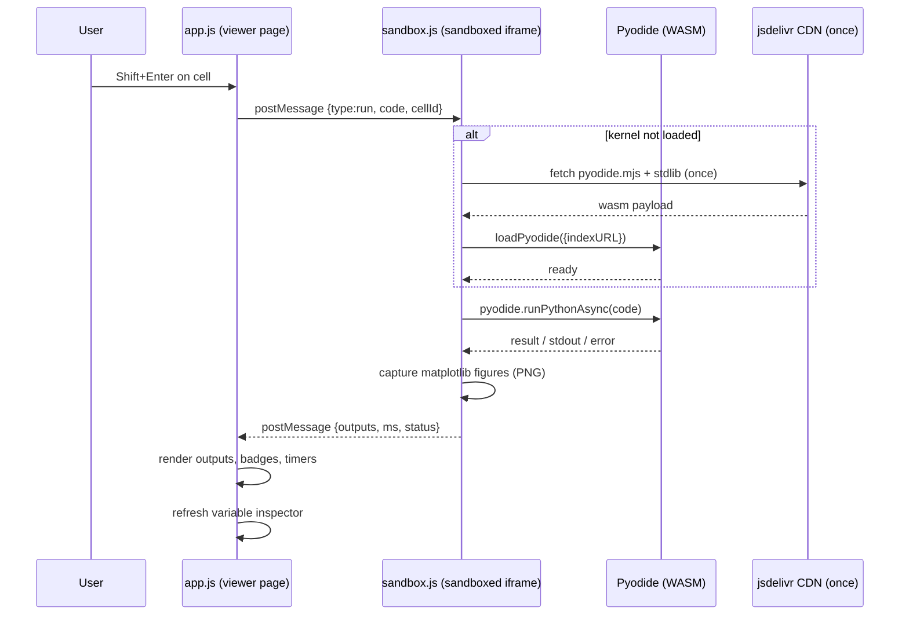

### Kernel bridge contract

| Message (APP → SB) | Payload | Meaning |
|---|---|---|
| `run` | `{code, cellId, execCount}` | Execute a cell |
| `runAll` | `{cells:[{code,cellId}]}` | Queue multiple cells |
| `restart` | `{}` | Tear down + reload Pyodide |
| `input` | `{cellId, prompt, value}` | Answer `input()` |
| `pip` | `{packages:[...]}` | `micropip.install` |
| `vars` | `{}` | Request variable list |
| `interrupt` | `{}` | Abort current run (best effort) |

| Message (SB → APP) | Payload | Meaning |
|---|---|---|
| `ready` | `{version, python}` | Kernel booted |
| `result` | `{cellId, outputs, ms}` | Cell finished |
| `error` | `{cellId, ename, evalue, traceback}` | Cell failed |
| `stdout` | `{cellId, text}` | Streaming output |
| `input-request` | `{cellId, prompt}` | `input()` needs a value |
| `vars` | `{items:[{name,type,preview,shape}]}` | Inspector data |
| `plots` | `{cellId, images:[dataURL]}` | Gallery images |

**Why a sandbox?** Extension pages must run only `'self'` scripts. Pyodide needs `wasm-unsafe-eval` and CDN fetches, so it lives in the MV3 `sandbox` page — full Python power, zero CSP weakening of the app itself. Untrusted notebook HTML is additionally sanitized before render.

---

## Data Flow and Notebook Lifecycle

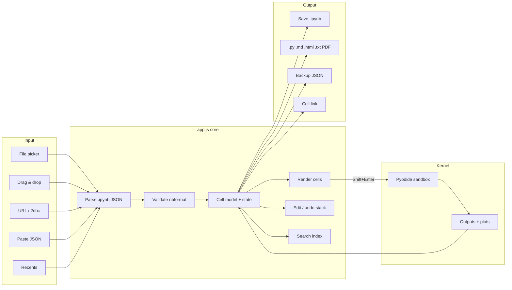

State lives in memory; persistence is limited to `chrome.storage.local` (recents, autosave snapshots, marks, notes, tools state) and whatever files you explicitly save or export.

---

## Sequence Flows — End-to-End Journeys

### Open + run + inspect a notebook

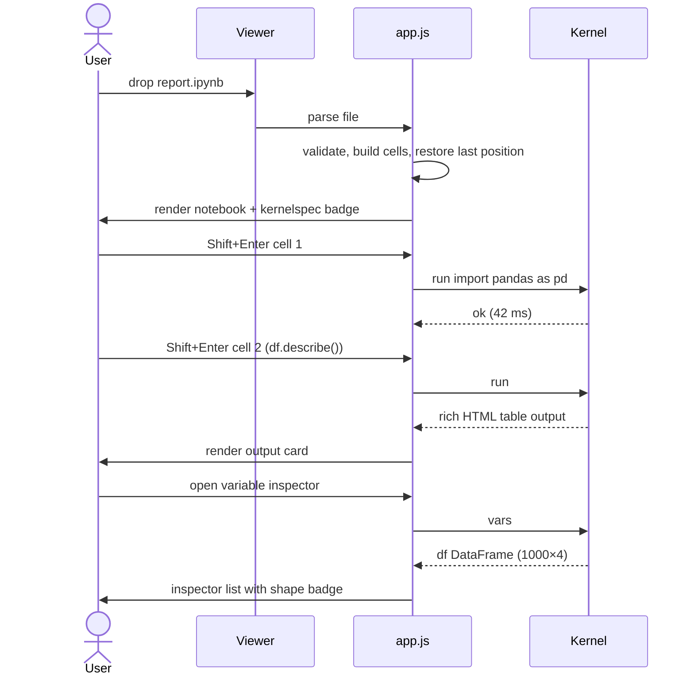

### Builder studio: chart wizard

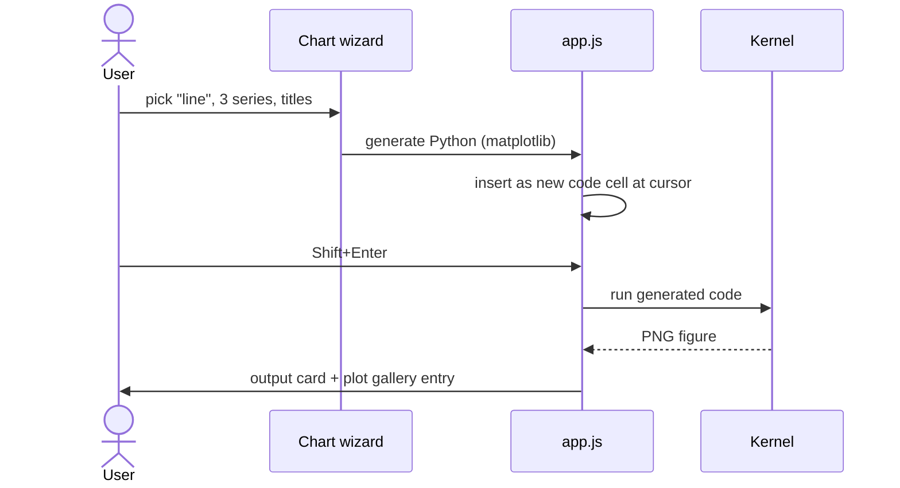

### Export pipeline

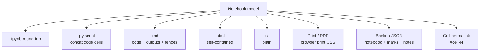

---

## Security Model — Sandboxing an Untrusted Notebook

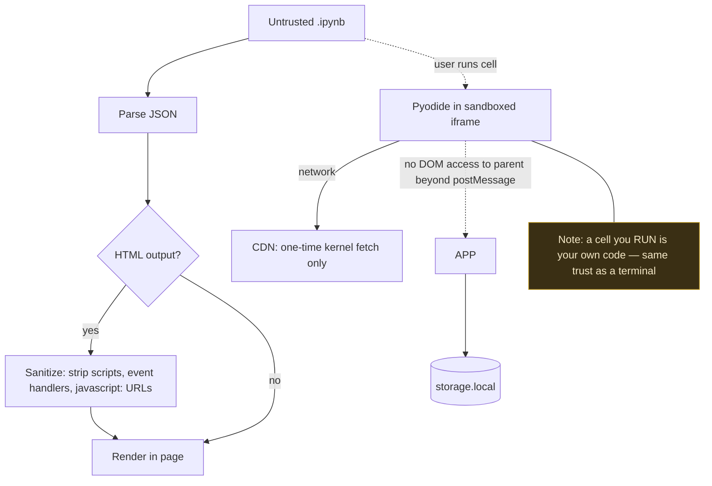

Rules the extension enforces:

1. Extension pages: `script-src 'self'` — no inline or remote scripts in the app.
2. Sandbox page: scripts allowed (required for Pyodide) but no access to extension APIs, storage or DOM of the parent — `postMessage` only.
3. Notebook HTML outputs are sanitized before insertion (scripts, `on*` handlers and `javascript:` URLs stripped).
4. Kernel network access exists only for the one-time Pyodide download and explicit `pip install` the user runs.
5. No cookies, no beacons, no analytics — grep the source and count the network calls: zero outside kernel boot / pip.

---

## State Management and Persistence

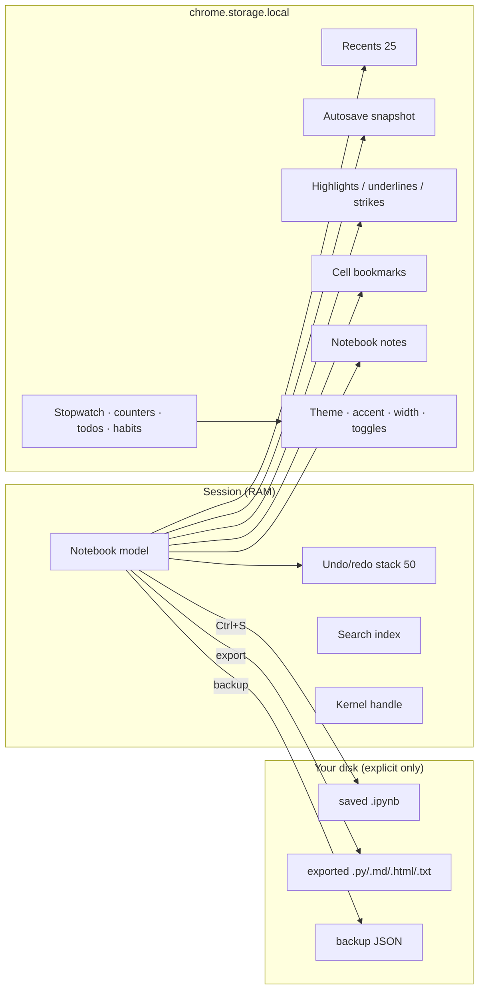

**Total storage footprint target:** well under 1 MB for typical use. Backups are a single JSON file you own.

---

## Export Engine

| Format | Contains | Typical use |
|---|---|---|
| `.ipynb` | Full notebook, outputs preserved | Round-trip to Jupyter |
| `.py` | Concatenated code cells with markers | Scripts, review, git diff |
| `.md` | Code fences + rendered outputs | Notes, docs, Obsidian |
| `.html` | Self-contained page, styled | Share without Jupyter |
| `.txt` | Plain text dump | Quick copy |
| Print / PDF | Print CSS, page breaks | Paper, archival |
| Backup JSON | Notebook + marks + notes + todos | Migration / restore |
| Cell link | `viewer.html?...#cell-N` | Deep-link a cell |
| Plot images | PNG per figure | Papers, slides |
| Execution stats | Timings, counts | Performance review |

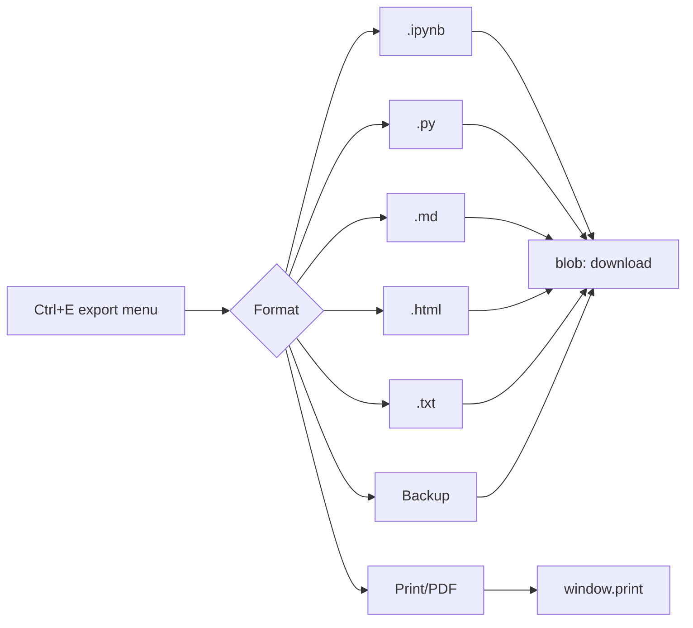

---

## Search and Outline Engine

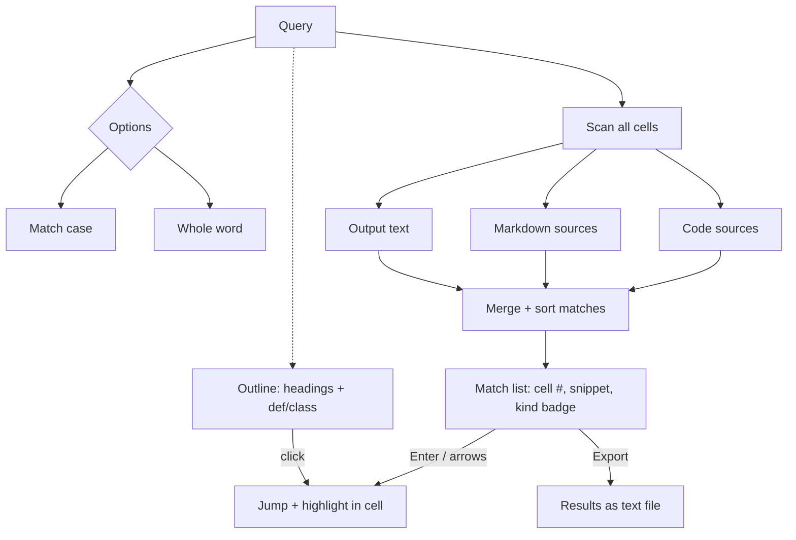

- Index rebuilds incrementally on edit (debounced), so search stays instant on large notebooks.
- Outline merges markdown headings and top-level `def` / `class` definitions with click-to-jump.

---

## Builder Studio and Wizards

| Builder | Output |
|---|---|
| Snippet gallery | 14 Python + 8 Markdown snippets, tap-to-insert at cursor |
| Table builder | Dialog → GFM table inserted as markdown cell |
| Chart wizard | line / bar / scatter / hist → generated matplotlib cell |
| CSV loader | Drag CSV → generated pandas load + head cell |
| Quick line chart | One-tap from selected numeric data |
| Pip installer cell | `!pip install <pkg>` cell with confirmation |
| JSON loader | Fetch/paste JSON → pretty-print cell |
| Callout builder | `> [!NOTE]` style callouts |
| Math block | `$$ ... $$` KaTeX-ready block |
| Details fold | `<details><summary>` collapsible block |
| Banner box | Decorative markdown banner |
| Task-list block | `- [ ]` checklist scaffold |

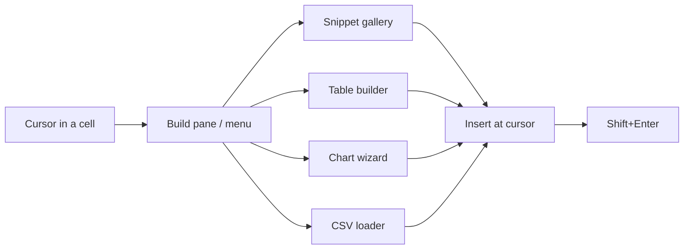

---

## Privacy and Security

| Question | Answer |
|---|---|
| Do notebooks upload anywhere? | **No.** Files are read in-memory via File/System Access APIs. |
| Any analytics or telemetry? | **None.** No tracking code exists in the repository. |
| Any accounts or licenses? | **None.** MIT, unlimited, forever. |
| Network calls? | One-time Pyodide CDN fetch at kernel boot + explicit `pip install`. View/edit/export work offline. |
| Where are recents/marks/todos? | `chrome.storage.local` in your browser profile only. |
| Can a malicious notebook steal data? | Outputs are sanitized; the kernel cannot touch extension APIs; runs are your own code, same trust model as a terminal. |
| Backup location? | A JSON file you download — never auto-uploaded. |

---

## Installation — 30 Seconds

### Chrome / Edge / Brave / Opera / Arc / Vivaldi / Yandex


1. Download the [latest release ZIP](https://github.com/Ahmedbakr78/Heros_Jupter/releases/latest) or `git clone https://github.com/Ahmedbakr78/Heros_Jupter.git`.
2. Open `chrome://extensions` — Edge: `edge://extensions`, Brave: `brave://extensions`, Vivaldi: `vivaldi://extensions`, Opera: `opera://extensions`, Yandex: `browser://extensions`.
3. Enable **Developer mode** (top-right).
4. **Load unpacked** → select the `Heros_Jupter` folder (the one containing `manifest.json`).
5. Pin **Heros NoteBook** and click the icon → the viewer opens.
6. Optional, for `file://` auto-open: **Details → Allow access to file URLs**.

**No install needed for reading:** open `viewer.html` directly in any browser — view, search, edit and export work standalone; the kernel needs the extension (or the sandbox page served normally).

**Updating:** download the new version → on the extension card press **Reload ↻** (or remove + load unpacked again). Version must read `1.1.0`.

**Mobile:** works as a full app in Kiwi Browser (Chromium) — load unpacked / install from zip the same way.

---

## Usage Guide

| You want to… | Do this |
|---|---|
| Open a notebook | `Ctrl+O`, or drag the file onto the page, or right-click a `.ipynb` → Heros NoteBook |
| Run a cell | Click it, then `Shift+Enter` (run + next) or `Ctrl+Enter` (run + stay) |
| Install a package | `!pip install pandas` in a cell, or Data pane → Package manager |
| Inspect variables | Data pane → Variable inspector (auto-refreshes after runs) |
| See every figure | Data pane → Plot gallery (all matplotlib PNGs this session) |
| Review timings | Data pane → Run history |
| Build a table | Build pane → Table builder |
| Chart without code | Build pane → Chart wizard |
| Find anything | `Ctrl+F` — code, markdown and outputs |
| Jump to a definition | Sidebar → Outline |
| Export | `Ctrl+E` → pick format |
| Save | `Ctrl+S` (write `.ipynb`) |
| Theme | `T` cycles dark/light/system; Design pane for accents + tints |
| Feature list | Press `F` |

---

## Keyboard Shortcuts — Complete Map

| Keys | Action |
|---|---|
| `Ctrl+O` | Open notebook |
| `Ctrl+S` | Save `.ipynb` |
| `Ctrl+E` | Export menu |
| `Ctrl+F` | Full-notebook search |
| `Ctrl+K` | Command palette |
| `Ctrl+B` | Toggle sidebar |
| `Shift+Enter` | Run cell + move to next |
| `Ctrl+Enter` | Run cell, stay |
| `Ctrl+Shift+Enter` | Run + insert below |
| `J` / `K` | Next / previous cell |
| `A` / `B` | Add cell above / below |
| `M` | Convert to markdown |
| `Y` | Convert to code |
| `V` | Paste cut cell |
| `X` / `C` / `D` | Cut / copy / delete cell |
| `E` | Toggle edit / preview |
| `O` | Toggle output visibility |
| `T` | Cycle theme |
| `F` | Feature list |
| `H` / `U` / `S` | Highlight / underline / strike selection |
| `?` | Help |
| `Esc` | Close overlay |

---

## Themes and Eye Comfort

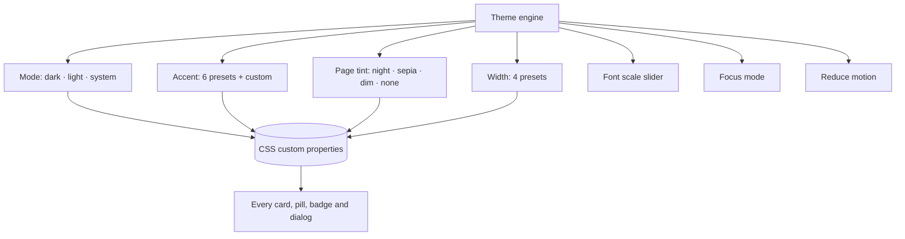

- **Studio-white** light mode tuned for bright rooms and printing.
- **True dark** deepened for night work (not just inverted gray).
- Six accent presets (blue, violet, teal, amber, rose, green) + custom color picker.
- Night (blue-block), sepia (paper) and dim (low-contrast-room) page tints behind the content column.
- Reduce-motion kills all animations for vestibular comfort.

---

## Responsive and Mobile-First

| Breakpoint | Behavior |
|---|---|
| ≥ 1100px | Full layout: sidebar + wide content + right panes |
| 768–1099px | Collapsible sidebar, standard content width |
| < 768px | Mobile drawer navigation, floating action bar, touch-sized targets |
| Kiwi Browser (Android) | Full extension support, installable as app |

---

## Performance Engineering

| Technique | Effect |
|---|---|
| Lazy output rendering | Off-screen outputs mount on scroll |
| Debounced search indexing | Typing never blocks the main thread |
| Per-cell timers via kernel timestamps | Accurate without polling |
| Image decode deferral | Heavy notebooks open fast |
| Single WASM kernel, reused | No per-cell boot cost |
| `willReadFrequently`-safe canvas use where applicable | Avoids Chromium readback warnings |
| Undo stack capped at 50 | Bounded memory |
| Recents capped at 25 | Bounded storage |

---

## Error Handling and Resilience

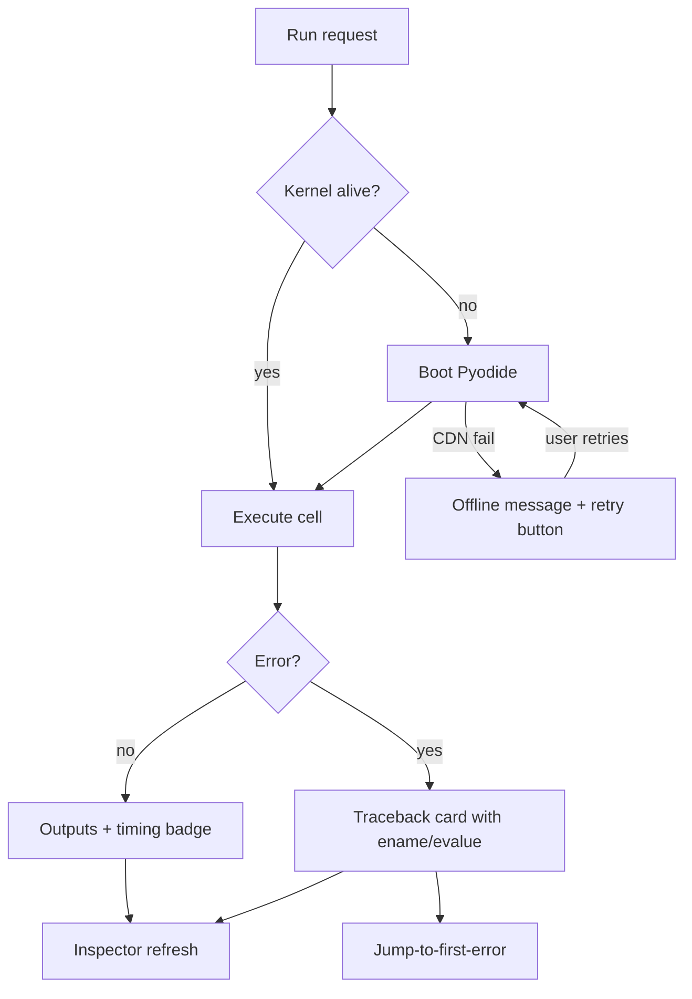

- Corrupt / non-notebook JSON → friendly parse error, no crash.
- Invalid nbformat → best-effort load with trust/validation notice.
- Kernel deadlock → auto-restart path + clear messaging (fixed in v1.1.0).
- Blocked CDN → explicit offline state; view/edit/export still work.

---

## Accessibility

| Feature | Status |
|---|---|
| Keyboard-first operation | Full — every action has a key or palette entry |
| Visible focus rings | Strengthened in v1.1.0 |
| ARIA labels on icon buttons | Yes |
| Reduced motion support | Dedicated toggle |
| Contrast | Dark and light both tuned for WCAG AA body text |
| Screen readers | Landmark structure + live regions for run status |

---

## Internals — Inside the Code

| File | Lines | Role |
|---|---|---|
| `viewer.html` | ~874 | App shell: full design system, panes, dialogs, static markup |
| `app.js` | ~3,478 | Notebook model, rendering, run orchestration, search, export, builders, tools |
| `sandbox.html` + `sandbox.js` | ~270 | MV3 sandbox page: Pyodide boot, runPythonAsync, pip, vars, plots |
| `background.js` | ~96 | Context menus, auto-open for `file://` + `https://` `.ipynb`, panel behavior |
| `popup.html` + `popup.js` | ~100 | Toolbar control center: toggles, quick open, version |
| `manifest.json` | MV3 | Permissions: `contextMenus`, `webNavigation`, `storage`; host `<all_urls>` |

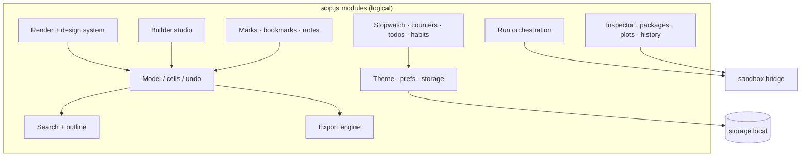

---

## Compatibility Matrix

| Browser | Version | Install method | Notes |
|---|---|---|---|
| Chrome | 108+ | Load unpacked / zip | Primary target |
| Edge | 108+ | Load unpacked | `edge://extensions` |
| Brave | any recent | Load unpacked | Shields do not affect it |
| Opera / Opera GX | any recent | Load unpacked | `opera://extensions` |
| Arc | any recent | Load unpacked | Via Chrome loader |
| Vivaldi | 5+ | Load unpacked | `vivaldi://extensions` |
| Yandex | any recent | Load unpacked | `browser://extensions` |
| Kiwi (Android) | any recent | Load unpacked | Full app experience |
| Firefox | — | Not yet | MV3 port on the roadmap |

---

## Project Stats

| Metric | Value |
|---|---|
| Free tools | 160 |
| Source lines (approx.) | ~4,800 |
| Dependencies bundled | 0 (Pyodide fetched at runtime by the kernel) |
| Permissions | 3 (`contextMenus`, `webNavigation`, `storage`) |
| Storage used | < 1 MB typical |
| Network calls | 2 categories: kernel boot, explicit pip |
| License | MIT |
| Price | Free, unlimited, forever |

---

## Repository Structure

```text
Heros_Jupter/
├── manifest.json        MV3, v1.1.0 — extension_pages script-src 'self'; sandbox for kernel
├── viewer.html          App shell + Heros-PDF-grade design system (~874 lines)
├── app.js               Viewer / runner / editor / search / export engine (~3,478 lines)
├── sandbox.html         Sandboxed kernel page (tiny)
├── sandbox.js           Pyodide bridge: boot, run, pip, vars, plots (~259 lines)
├── background.js        Context menus + auto-open .ipynb (file:// and https://)
├── popup.html / js      Toolbar control center
├── icons/               logo + 16 / 32 / 48 / 128
├── docs/                GitHub Pages website (index.html)
├── .github/             Issue templates, PR template, release notes
├── CHANGELOG.md         Every version
├── REPO_META.md         GitHub About / topics / pages setup (source of truth)
├── CONTRIBUTING.md      How to contribute
├── CODE_OF_CONDUCT.md   Contributor Covenant
├── SECURITY.md          Vulnerability reporting
├── SUPPORT.md           Where to get help
└── LICENSE              MIT
```

Load-unpacked folder: the repository root itself (where `manifest.json` lives).

---

## Tech Stack

| Layer | Choice | Why |
|---|---|---|
| Language | Vanilla JavaScript (ES2022) | Zero build step, zero deps, auditable |
| Extension platform | Manifest V3 | Required by Chromium, future-proof |
| Kernel | Pyodide (CPython → WASM) | Real Python, no server, no install |
| Storage | `chrome.storage.local` | Fast, profile-local, no quota tricks |
| Rendering | Hand-rolled DOM + CSS custom properties | The Heros design system, 60 fps |
| Security | MV3 sandbox page + HTML sanitizer | Python power without weakening the app |
| License | MIT | Free forever |

No frameworks, no bundlers, no npm. What you load is what runs.

---

## Roadmap

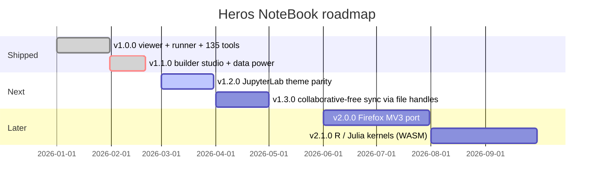

- **v1.2.0** — cell toolbar polish, richer DataFrame viewer (sort/filter), notebook diff
- **v1.3.0** — File System Access live-link (auto-reload on file change), workspace folders
- **v2.0.0** — Firefox MV3, store-ready packaging
- **v2.1.0** — additional WASM kernels (R, Julia)

Ideas welcome in [Discussions / Issues](https://github.com/Ahmedbakr78/Heros_Jupter/issues).

---

## Contributing

Read [`CONTRIBUTING.md`](./CONTRIBUTING.md). Short version:

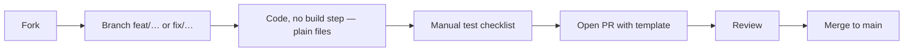

- Keep the zero-dependency rule.
- Match the existing code style (vanilla ES, no semicolon-free chaos, clear names).
- Update `CHANGELOG.md` and bump `manifest.json` version for user-facing changes.
- Never commit secrets, `.DS_Store`, or editor junk (`.gitignore` covers it).

---

## FAQ — 30 Questions

1. **Is it really free?** Yes — MIT, unlimited notebooks, cells, runs and exports. No accounts, ever.
2. **Do I need Python installed?** No. Python runs inside the browser via Pyodide WebAssembly.
3. **Does it need Jupyter or a server?** No. There is no server component at all.
4. **Where do my notebooks go?** Nowhere. They stay in memory and on your disk.
5. **Does it work offline?** Viewing, editing, search and export work fully offline. The kernel needs one CDN fetch the first time it boots each session; after boot, runs work offline for already-installed packages.
6. **Which Python version?** Pyodide's current CPython 3.x build (badge shows the live version at kernel boot).
7. **Can I pip install packages?** Yes — `!pip install name` in a cell or the Package manager pane (pure-Python wheels; many scientific packages are supported by Pyodide).
8. **Does matplotlib work?** Yes — figures are captured inline as PNG outputs and collected in the plot gallery.
9. **Does pandas / numpy work?** Yes — both ship in Pyodide; DataFrames show shape badges in the inspector.
10. **Can I run notebooks from URLs?** Yes — Open → URL, or `?nb=<url>` deep link.
11. **What about large notebooks?** Outputs lazy-render; search is indexed; recents and undo are capped. Very large notebooks (100 MB+) will feel heavy in any viewer.
12. **Can it open password-protected or exotic notebooks?** Standard nbformat v4 is supported; exotic vendor extensions are not guaranteed.
13. **Is my code executed automatically?** Never. Cells run only when you press Run keys.
14. **Can a notebook escape the sandbox?** The kernel runs in an MV3 sandboxed iframe without access to extension APIs or your disk; output HTML is sanitized. Running a cell is trusting that code, like a terminal.
15. **Does it phone home?** Only the kernel boot + pip fetch. Zero analytics.
16. **How do I update?** Download new version → Reload the extension card.
17. **Can I use it on Android?** Yes, via Kiwi Browser.
18. **Dark mode?** Dark, light, system, plus night/sepia/dim tints and six accents.
19. **Can I export to PDF?** Yes — Print / PDF via the browser print dialog with dedicated print CSS.
20. **Does round-trip to Jupyter work?** Yes — saved `.ipynb` opens in JupyterLab/Notebook (outputs included).
21. **Undo how far?** 50 steps of cell-level edits.
22. **Multiple notebooks at once?** Open additional viewer tabs; each holds its own model + kernel.
23. **Keyboard-only?** Yes — nearly every action has a shortcut; `Ctrl+K` covers the rest.
24. **What about Jupyter magic commands?** Common safe magics are handled; the kernel errors clearly on unsupported ones.
25. **Can I collaborate live?** Not yet — file-handle live-link is on the v1.3 roadmap.
26. **Does it work in Firefox?** Not yet — v2.0 roadmap.
27. **Is there a store listing?** Not yet; it is load-unpacked today. Store packaging is planned.
28. **How do I report a bug?** [Issues](https://github.com/Ahmedbakr78/Heros_Jupter/issues/new/choose) — template asks for notebook sample, browser and console log.
29. **Can I contribute?** Absolutely — see [`CONTRIBUTING.md`](./CONTRIBUTING.md).
30. **Who builds this?** [Ahmed ABOBAKR](https://github.com/Ahmedbakr78) — same author as Heros PDF, Heros Markdown, Heros Todo and markClipper.

More help: [`SUPPORT.md`](./SUPPORT.md). Security: [`SECURITY.md`](./SECURITY.md).

---

## Changelog and Releases

See [`CHANGELOG.md`](./CHANGELOG.md) for every version. Latest:

**v1.1.0 — MAX update (135 → 160 tools)**

- Builder studio: snippet gallery (14 Python + 8 Markdown), table builder dialog, chart wizard (line/bar/scatter/hist), tap-to-insert at cursor
- Data power: live variable inspector (type, preview, DataFrame shapes), variable detail + print-cell, package manager (install + list), plot gallery, run history with timings
- Studio-white light mode + deepened dark, cell hover polish, stronger focus rings, reduce-motion switch
- Profile colors, markdown raw-HTML rendering (trusted/sanitized), empty-cell UX hints, kernel deadlock + tint corruption fixes
- Sidebar Build pane, menu Build section, dynamic feature counting

**v1.0.0 — First release**: viewer + Pyodide runner + editor + search + export + 135 tools.

To publish a release on GitHub: **Releases → Draft new release → tag `v1.1.0`** → paste the notes above → attach `heros-notebook-v1.1.0.zip`.

---

## GitHub Topics, About and Website Setup

Copy-paste source of truth: [`./REPO_META.md`](./REPO_META.md). It contains the exact About description, website URL, 20 topics, social preview and release notes.

Enable the website in 20 seconds: **Settings → Pages → Deploy from branch → `main` + `/docs`** → Save → live at `https://ahmedbakr78.github.io/Heros_Jupter/`.

```bash
gh repo edit Ahmedbakr78/Heros_Jupter \
  --add-topic jupyter --add-topic ipynb --add-topic notebook \
  --add-topic python --add-topic pyodide --add-topic chrome-extension \
  --add-topic manifest-v3 --add-topic offline-first --add-topic privacy \
  --add-topic free --add-topic markdown --add-topic matplotlib \
  --add-topic data-science --add-topic vscode-jupyter \
  --add-topic dark-mode --add-topic side-panel \
  --add-topic vscode-extensions --add-topic wasm \
  --add-topic study-tools --add-topic open-source
```

---

## Related Projects

| Project | What it is |
|---|---|
| [Heros PDF](https://github.com/Ahmedbakr78/Heros_PDF) | PDF viewer/editor studio — the design system Heros NoteBook was forged in |
| [Heros Markdown](https://github.com/Ahmedbakr78/heros-markdown) | Markdown viewer with LaTeX + every mermaid diagram |
| [Heros Todo](https://github.com/Ahmedbakr78/Heros_Todo) | Markdown + PDF + LaTeX side-panel studio with tasks |
| [Heros Player](https://github.com/Ahmedbakr78/Heros_Music_Player) | Remote control for YouTube Music / Spotify tabs |
| [markClipper](https://github.com/Ahmedbakr78/Heros_Note) | Web clipper → perfect Markdown notes + photo lab |
| [Heros Shell](https://github.com/Ahmedbakr78/Heros_Shell) | Browser shell tools |

---

## License and Credits

**MIT** — Copyright 2026 Ahmed ABOBAKR (Ahmedbakr78). See [`LICENSE`](./LICENSE). Do anything, just keep the notice.

Maintainer: [Ahmed ABOBAKR](https://github.com/Ahmedbakr78) · [LinkedIn](https://www.linkedin.com/in/ahmed-abo-bakr-1b2466288/)

Built on giants:

- [Pyodide](https://pyodide.org/) (MPL-2.0, Mozilla) — CPython compiled to WebAssembly
- [Jupyter](https://jupyter.org/) `.ipynb` format (BSD-3-Clause) — the notebook spec this app reads and writes
- The Heros family: PDF · Markdown · Todo — design language and UX patterns, used with gratitude

---

<div align="center">

### If Heros NoteBook saves you time, star it — it takes 2 seconds and keeps us building.

[](https://github.com/Ahmedbakr78/Heros_Jupter/stargazers)
[](https://github.com/Ahmedbakr78/Heros_Jupter/fork)
[](https://github.com/Ahmedbakr78/Heros_Jupter/issues)

**Made with care by Ahmed ABOBAKR ([Ahmedbakr78](https://github.com/Ahmedbakr78) · [LinkedIn](https://www.linkedin.com/in/ahmed-abo-bakr-1b2466288/)) — free forever, private forever.**

</div>
